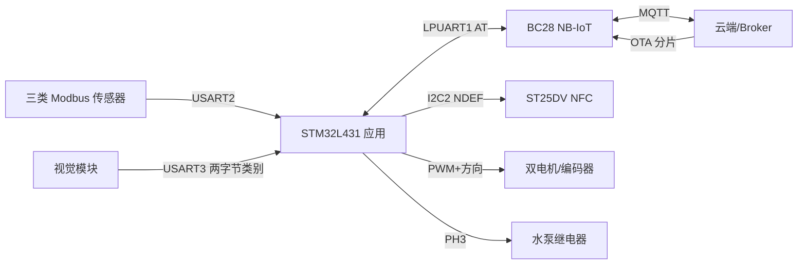

# L4_v1.0 固件规格说明（SPECS）

> 版本：v1.0 代码基线与目标验收规格  
> 编写日期：2026-10-05  
> 对应项目：`F:\Orange\L4_v1.0\L4_v1.0`  
> 阅读约定：**现状**指源码中可直接确认的行为；**要求**指交付前应满足的可测试约束；**待确认**指缺少原理图、Bootloader、服务端或实机证据的项目。

## 1. 系统边界与依赖

应用运行在 STM32L431RCT6（Cortex-M4）上，使用 STM32 HAL、Keil MDK-ARM 工程。外部依赖包括三个 Modbus RTU 传感器、BC28 NB-IoT 模组及 MQTT Broker、USART3 视觉模块、ST25DV NFC 标签、两路电机与编码器、水泵继电器，以及独立 Bootloader。`Drivers/AI/libneai.a` 提供 NanoEdgeAI 异常检测实现。



## 2. 硬件、存储与任务模型

| 项目 | 现状 |
| --- | --- |
| MCU/时钟 | STM32L431RCT6；`.ioc` 配置系统时钟 80 MHz |
| 传感器总线 | USART2，9600 8N1；地址 `0x01` 风速、`0x02` 空气、`0x03` 土壤 |
| 蜂窝模块 | LPUART1，9600 8N1；BC28 AT 指令与 MQTT URC 共用串口 |
| 视觉接口 | USART3，9600 8N1；`0x01` 帧头 + 1 字节类别 |
| NFC | I2C2，ST25DV；NDEF Text Record（UTF-8，语言代码 `zh`） |
| 双轴驱动 | TIM15 CH1/CH2 PWM；TIM1/TIM2 编码器；控制逻辑使用 PC7/PC8、PC9/PB1 方向 GPIO |
| 水泵 | `Water_beng` 标记的 PH3，低电平为关、高电平为开（以当前代码为准） |
| 主循环 | 裸机轮询；UART 单字节中断进环形缓冲，主循环处理 Modbus、MQTT、YOLO、OTA；周期任务使用 `HAL_GetTick()` |
| 缓冲 | USART2 256 B、LPUART1 4096 B、USART3 64 B；MQTT 行缓存 1536 B、OTA 二进制帧缓存 256 B |

Flash 布局由 `ota_global.h` 与 `MDK-ARM/L4/L4.sct` 定义：Boot `0x08000000` 起 32 KiB；APP `0x08008000` 起 40 KiB；NEW `0x08012000` 起 40 KiB；Flag `0x0801C000` 起 4 KiB。声明的 Flash 总量为 256 KiB。当前工程只包含应用，未包含 Bootloader；槽位切换/回滚行为不能仅凭本仓库证明。最近保留的构建日志显示 0 error、0 warning、Code 34348 B、RO 1080 B，但它不是本次重新编译结果。

## 3. 功能需求（EARS 格式）

| ID | 要求 | 当前证据/差异 |
| --- | --- | --- |
| FR-01 | 当设备启动时，系统应初始化串口、I2C、定时器、RTC、GPIO、OTA、AI 与 NFC，并让水泵保持关闭。 | `main.c` 有初始化和 PH3 复位。 |
| FR-02 | 当到达配置的采样周期时，系统应依次读取三个 Modbus 从站，验证地址、功能码、字节数和 CRC 后更新八项数据。 | 轮询与 CRC 已有；当前周期门限为 `>10000 ms`，注释称 30 秒；无数据新鲜度标志。 |
| FR-03 | 当一轮采集完成且 MQTT 可用时，系统应发布风速、空气、土壤三类遥测，并将该轮数据写入 NFC。 | 当前只有启动时 `mqtt_connected=1` 才执行整个周期任务；离线时连采集/NFC 都暂停。 |
| FR-04 | 当视觉端提交合法非健康类别时，系统应发布一条对应病害事件；收到健康类或未知类别时应忽略。 | `yolo.c` 已实现类别 0/1/2/4 上报。 |
| FR-05 | 当 NanoEdgeAI 检测结果正常返回且相似度低于 80 时，系统应根据阈值生成原因字段并发布环境异常事件。 | `main.c`、`judge.c` 已实现；若规则没有命中，当前仍可能发布 `anomaly:false`。 |
| FR-06 | 当收到合法水泵控制命令时，系统应只对 `val=0/1` 改变继电器状态；上电或非法命令时应保持安全状态。 | GPIO 处理已写；标准 JSON 截取逻辑需要修复和联调。 |
| FR-07 | 当收到合法移动命令时，系统应把 X/Y 参数限定在 0–5，先运行 X 再运行 Y；各轴到达目标或 30 秒超时后应停止。 | 阻塞式运动已写；位置参数当前被截断至 0–5，第二电机 GPIO 初始化未见。 |
| FR-08 | 当 OTA START 帧有效时，系统应校验大小、帧数、对齐及 CRC 参数，擦除 NEW 槽并应答 ready；无效时应拒绝。 | 应用侧已实现大部分检查；有效 `chunk_size` 还受 MQTT 解码器 200 B 上限约束。 |
| FR-09 | 当 OTA DATA 帧有效时，系统应按任务号/序号写入 NEW 槽、读回校验并逐帧应答；重复帧不得再次写 Flash。 | 已实现位图去重；接收侧滚动 CRC 假定数据按序到达。 |
| FR-10 | 当 OTA END 帧到达时，系统应在帧数、总字节数、接收 CRC32 与 Flash CRC32 全部匹配后设置待激活标志并重启。 | 应用侧已有；Bootloader 执行与回滚需外部验证。 |
| FR-11 | 当 120 秒没有收到 OTA 数据帧时，系统应结束下载并保持原应用可启动。 | 应用状态机会转 FAILED；断电/重启恢复由 Bootloader 合约决定。 |
| FR-12 | 当通信或传感器失败时，系统应提供可观测错误，并避免把未更新的数据作为新数据发布或执行不完整控制命令。 | 当前缺少完整的失败状态、新鲜度、重连和控制回执；列为交付差距。 |

## 4. Modbus RTU 数据规格

请求均为功能码 `0x03`，响应末尾为 Modbus CRC16（低字节在前，多项式 `0xA001`）。现有硬编码请求分别读取 1、4、3 个寄存器。

| 从站 | 请求寄存器 | 响应数据 | 解析结果与单位 |
| --- | --- | --- | --- |
| `0x01` 风速 | 起始 `0x0000`，1 个 | 2 B | 无符号值 ÷10，风速；具体物理单位需传感器手册确认，代码未标注 |
| `0x02` 空气 | 起始 `0x0000`，4 个 | 8 B | 温度有符号 ÷10 °C；湿度无符号 ÷10 %；光照无符号 ×10 lux；气压无符号 ÷10 hPa |
| `0x03` 土壤 | 起始 `0x0000`，3 个 | 6 B | 温度有符号 ÷10 °C；湿度无符号 ÷10 %；pH 无符号 ÷100 |

当前接收解析把数据写进全局最近值；超时没有清零或标记失效。`light_intensity` 为 `uint16_t`，乘 10 后可能溢出。解析前还应确保 `3 + data_len + 2 <= 32`，避免临时缓冲越界；当前 `FindModbusFrame()` 仅与环形缓冲可用长度比较。

## 5. MQTT 与外部接口

当前 Broker 端点、客户端标识和凭据配置于 `Core/Inc/Connect.h`；本规格不复制口令。量产应使用可安全配置的设备身份和访问控制。MQTT 主题如下：

| 方向 | 主题 | Payload/用途 | 当前 QoS |
| --- | --- | --- | --- |
| 上行 | `test/topic` | 三条遥测 JSON | 发布命令 QoS 0 |
| 上行 | `anomaly/report` | 环境异常或病害事件 | QoS 0 |
| 下行 | `cmd/led` | 水泵/XY JSON 命令；名称为历史遗留 | 订阅 QoS 0 |
| 下行 | `device/citrus_001/ota/down` | OTA 二进制帧的大写 Hex 文本 | 订阅 QoS 1 |
| 上行 | `device/citrus_001/ota/up` | OTA ACK JSON | 发布命令 QoS 0 |

遥测格式（字段名以源码为准）：

```json
{"id":1,"wind":2.5}
{"id":2,"temp":25.3,"hum":65.2,"lux":12340,"pa":1013.2}
{"id":3,"s_temp":22.1,"s_hum":75.3,"ph":6.86}
```

`pa` 字段当前承载 hPa 数值，不是 Pa。异常事件格式是 `{"anomaly":true,"reasons":{"air_temp":"high"}}`，病害格式是 `{"disease":"blackspot","id":0}`。环境规则边界见下表；**超过/低于**才告警，等于边界不告警。

| 指标 | 正常边界/规则 | 告警键 |
| --- | --- | --- |
| 风速 | `<=5.0` | `wind=high` |
| 空气温度 | `15.0–35.0` | `air_temp=low/high` |
| 空气湿度 | `45.0–85.0` | `air_hum=low/high` |
| 光照 | `5000–15000` lux | `lux=low/high` |
| 气压 | `1000.0–1030.0` hPa | `pa=low/high` |
| 土壤温度 | 空气温度 ±10.0 °C | `s_temp=low/high` |
| 土壤湿度 | `50.0–88.0` | `s_hum=low/high` |
| 土壤 pH | `5.0–7.0` | `ph=low/high` |

控制命令目标格式：

```json
{"cmd":"pump","val":1}
{"cmd":"pump","val":0}
{"cmd":"move","x":2,"y":3}
```

`move` 的每个单位对应 5 圈，范围 0–5，依次运行电机 1（X）和电机 2（Y），速度参数为 500，单轴超时 30 秒。**现状差异**：`Process_CMD_Payload()` 通过首对双引号截取所谓 JSON，标准 JSON 会在 `"cmd"` 后被截断，因此上述格式尚不能视为已联调可用；应以完整 URC/payload 边界解析并添加正反例测试。

## 6. NFC 与视觉接口

ST25DV 通过 I2C2 写入 NDEF Text Record，内容为八项中文标签与数字，使用空格分隔。只有联网周期任务执行到采集末尾时才调用写入。`ST25DV_WriteBytes()` 当前忽略 HAL 返回值，产品验收应验证写入成功与手机端可读，并限定 NDEF 缓冲和文本长度。

视觉接口为两字节 `[0x01, class_id]`。类别映射：`0=blackspot`、`1=canker`、`2=greening`、`3=healthy`、`4=melanose`。无校验、长度、时间戳或置信度；超出 0–4 的类别直接丢弃。模型推断由外部视觉模块负责。

## 7. OTA 协议与状态

下行 MQTT payload 是二进制帧转成的大写 Hex。二进制帧格式：`AA 55 | CMD(1) | BODY | CRC16_LE(2) | DD`。CRC16 覆盖 `AA 55`、`CMD`、`BODY`；多字节 BODY 字段为大端。CMD 为 `0x01 START`、`0x02 DATA`、`0x03 END`。

| 帧 | BODY 字段顺序 | 二进制总长度 |
| --- | --- | --- |
| START | `task_no:u16, total_size:u32, total_frames:u16, chunk_size:u16, crc32:u32` | 20 B |
| DATA | `task_no:u16, seq:u16, total_frames:u16, data_len:u16, data[data_len]` | `14 + data_len` B |
| END | `task_no:u16, file_size:u32, total_frames:u16, crc32:u32` | 18 B |

整体 CRC32 使用 IEEE/zlib 算法：初值与最终异或均为 `0xFFFFFFFF`，反射多项式 `0xEDB88320`。START 限制镜像 `1–40960 B`、帧数 `1–1024`、`chunk_size` 为 8 的倍数且至少 128 B；MQTT Hex 解码又把 DATA 的 `data_len` 限为不大于 200 B，因此服务端应选 `chunk_size=128、136、…、200 B` 中的兼容值，末帧可更短。服务端还应按 `seq` 顺序发送，因为当前接收 CRC32 按到达顺序滚动计算。

ACK 发布到上行 OTA 主题，格式为 `{"cmd":"ota_start_ack|ota_data_ack|ota_end_ack","task_no":N,"seq":N,"status":"ready|ok|fail"}`；只有 DATA ACK 带 `seq`。ACK 发布函数不等待 Broker 最终确认，服务端应以实际收到 ACK 为准，并对丢失 ACK 做同任务/同序号重传。

```text
IDLE --有效 START--> DOWNLOADING --完整 END--> VERIFYING --> ACTIVATING --> SUCCESS --> 重启
  |                   |                    |              |
  +--无效 START------> FAILED <---写入/读回/CRC/参数失败--+
                      ^
                      +---- 下载空闲超过 120 s ---- DOWNLOADING
```

试运行确认在 `OTA_ConfirmBoot()`：应用检查标志区 `active_slot=NEW && confirmed=0` 后写入 `confirmed=1`。Bootloader 何时置位 `active_slot`、如何处理重启/断电/回滚，须以其独立规格和实测为准。当前项目没有镜像签名或加密验证；CRC 只能检查传输完整性。

## 8. 错误处理与安全约束

| 条件 | 应有行为 | 当前实现/待办 |
| --- | --- | --- |
| Modbus 响应 CRC 错、超时或数据长度异常 | 不更新该从站值，记录错误和新鲜度 | CRC 错会丢弃；超时/新鲜度未实现；长度上界需补 |
| MQTT 初连失败或运行中掉线 | 限频重连，采样可继续，控制保持安全态 | 仅启动尝试一次连接；无持续重连 |
| 控制 JSON 格式错误、缺字段或越界 | 不执行并产生可追踪拒绝结果 | 当前解析不可靠；越界采用截断；无控制 ACK |
| 电机编码器停滞或达 30 秒 | 立即停机并报告原因 | 30 秒停机已有；编码器停滞检测/回执未实现 |
| 水泵意外复位或通信丢失 | 默认关泵；是否自动关闭已开启泵需定义 | 启动默认关闭；运行中通信丢失未关泵 |
| NFC I2C 写入失败 | 标记本次 NFC 数据不可用并记录错误 | 当前 HAL 返回值被忽略 |
| OTA 错误帧、缺帧、CRC 不符或超时 | 不设置待激活标志，不破坏 APP；回报失败 | 应用侧部分实现；与 Bootloader 的恢复联调缺失 |
| 串口环形缓冲溢出 | 计数、丢弃不完整消息并恢复同步 | LPUART 行缓存有清空逻辑；环形缓冲溢出没有完整诊断 |

非功能验收基线：应用镜像不得超过 40 KiB；所有网络输入在复制前校验长度；中断回调仅做短操作；Flash 写入期间的串口丢帧/延迟须通过最大片段联调；量产凭据不得硬编码公开值；控制和 OTA 来源必须经过设备级授权。具体在线率、续航、端到端上报时延、误报率需业务方给出数值后才能作为量产门槛。

## 9. 可执行验收场景

| ID | Given / When / Then |
| --- | --- |
| AC-01 | 给定三个从站正常；当周期触发；则三条遥测依次到达且八项值与模拟寄存器换算一致。 |
| AC-02 | 给定某从站返回错误 CRC/超时/超长字节数；当处理该响应；则不更新为无效值、不越界，并能识别本轮该从站数据失效。 |
| AC-03 | 给定一次完整采集；当手机读取 NFC；则看到八项最新值；I2C 写失败时设备记录失败。 |
| AC-04 | 给定视觉类别 0/1/2/4、3、5；当分别输入 USART3；则只有四种病害产生正确上报，健康和非法值无事件。 |
| AC-05 | 给定 AI 返回成功且相似度 79、80；当完成一轮采集；则仅 79 触发规则事件，并按边界值校验原因字段。 |
| AC-06 | 给定标准 `+QMTRECV` 水泵开/关 JSON；当下发；则继电器分别开/关；畸形或非法命令不改变状态。 |
| AC-07 | 给定 `move x=2,y=3`；当下发；则 X 行 10 圈后停止、Y 行 15 圈后停止；无编码器脉冲时不超过 30 秒停机。 |
| AC-08 | 给定 Broker 断连并恢复；当周期继续；则采样不中断且恢复后能重新上报，不把旧数据误标为新数据。 |
| AC-09 | 给定合法 OTA 镜像；当按序发送 START/DATA/END；则逐帧 ACK、CRC32 一致、设置 pending 标志、重启并由 Bootloader 启动新镜像。 |
| AC-10 | 给定重复 DATA、缺帧、错 CRC、超时和升级中断电；当分别重试；则无重复写导致的破坏，错误镜像不激活，设备仍能启动旧版本。 |

AC-06 至 AC-10 中涉及当前差距或外部 Bootloader 的结果，须修复/联调后才可勾选通过。

## 10. 实施与联调清单

- [ ] 确定正式采样周期、传感器单位/寄存器表、阈值来源与设备名称。
- [ ] 修复 MQTT `+QMTRECV` 命令 payload 解析，测试转义引号、超长行、缺字段和非法数值。
- [ ] 核对电机方向线、STBY/PC8 复用、PC9/PB1 GPIO 初始化及驱动原理图。
- [ ] 增加传感器新鲜度、超时、Modbus 长度上界、NFC I2C 错误与控制执行回执。
- [ ] 增加 MQTT 断线检测和重连；明确离线采样与泵运行策略。
- [ ] 统一 OTA `chunk_size` 与 200 B 解码限制，验证按序/重复帧及 ACK 丢失重传。
- [ ] 补充 Bootloader 源码/合约，实测槽位切换、确认、失败回滚和断电恢复。
- [ ] 替换固定 MQTT 凭据，定义设备身份认证及签名固件验证方案。
- [ ] 用 Keil 重新构建并记录 ROM/RAM/栈占用；执行 AC-01 至 AC-10 并保存证据。

## 11. 溯源文件

`L4.ioc`；`Core/Src/main.c`、`Connect.c`、`MqttTask.c`、`yolo.c`、`judge.c`、`ST25DV.c`、`Motor.c`、`encoder.c`、`ota_app.c`、`ota_crc32.c`、`gpio.c`、`usart.c`；`Core/Inc/Connect.h`、`encoder.h`、`ota_app.h`；`Core/Src/ota_global.h`；`MDK-ARM/L4/L4.sct`、`MDK-ARM/L4/L4.build_log.htm`。
